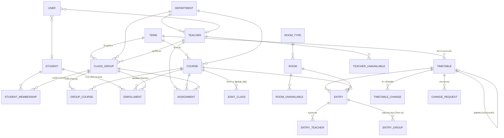

# สถาปัตยกรรมและการออกแบบระบบ NVC Smart Timetable

เอกสารนี้อธิบายการออกแบบที่ **ใช้งานจริงอยู่ในโค้ด** ทุกหัวข้ออ้างอิงไฟล์ในโครงการ (โฟลเดอร์ราก `nvc_timetable/`)

---

## 1. สถาปัตยกรรมระบบ

แบ่งเป็น 4 ชั้น ชั้นบนเรียกใช้ชั้นล่างได้เท่านั้น และ **ตรวจสิทธิ์ที่ชั้นบริการ** (ไม่ใช่แค่ซ่อนปุ่ม)

```
┌──────────────────────── ชั้นหน้าเว็บ (Streamlit) ────────────────────────┐
│ streamlit_app.py  → เมนูตามสิทธิ์ (st.navigation)                          │
│ nvc/ui/p_*.py     → หน้าเว็บแต่ละหน้า  ·  nvc/ui/common.py → ธีม/ผู้ใช้/ภาคเรียน │
└───────────────────────────────┬──────────────────────────────────────────┘
┌──────────────────────── ชั้นบริการ (ตรวจสิทธิ์ทุกฟังก์ชัน) ─────────────────┐
│ auth.py  permissions.py  audit.py          ยืนยันตัวตน / สิทธิ์ / ประวัติ     │
│ importer/ readers → mapping → loader      นำเข้าหลายไฟล์                    │
│ readiness.py                               ตรวจความพร้อมก่อนจัด              │
│ timetable_service.py                       ฉบับตาราง แก้ไข ย้อนกลับ อนุมัติ    │
│ views.py → render.py → export/exporters.py มุมมองตามสิทธิ์ แสดงผล ส่งออก      │
└───────────────┬───────────────────────────────────┬──────────────────────┘
┌───────── ชั้นอัลกอริทึม (ไม่แตะฐานข้อมูลโดยตรง) ─────────┐  ┌── ชั้นตรวจสอบอิสระ ──┐
│ problem.py  แปลงข้อมูล → รายการสอนที่ต้องจัด              │  │ validator.py         │
│ solver.py   OR-Tools CP-SAT                              │  │ อ่านตารางที่บันทึกแล้ว │
└─────────────────────────────┬────────────────────────────┘  │ ตรวจ 22 หัวข้อซ้ำ     │
┌───────────────────────── ชั้นข้อมูล ──────────────────────────┴──────────────┐
│ models.py (SQLAlchemy ORM 26 ตาราง)  db.py (ธุรกรรม)  settings_service.py      │
│ PostgreSQL (ใช้งานจริง) / SQLite (พัฒนา-ทดสอบ)   config.py อ่าน DATABASE_URL    │
└──────────────────────────────────────────────────────────────────────────────┘
```

หลักการสำคัญ
- **ตัวจัดกับตัวตรวจแยกกัน** `solver.py` สร้างตาราง ส่วน `validator.py` คำนวณความต้องการจากฐานข้อมูลใหม่ด้วยโค้ดของตัวเอง ถ้าตัวจัดผิดพลาด ตัวตรวจจะจับได้
- **ไม่มีข้อมูลจำลองในระบบจริง** ทุกตัวเลขบนแดชบอร์ดมาจากการ query ฐานข้อมูล
- **ทุกการเปลี่ยนแปลงเป็นธุรกรรม** `db.session_scope()` จะ commit เมื่อสำเร็จทั้งหมด และ rollback เมื่อเกิดข้อผิดพลาด
- **ค่าลับไม่อยู่ในโค้ด** `DATABASE_URL` อ่านจาก Secrets หรือตัวแปรสภาพแวดล้อม ส่วนรหัสผ่านเริ่มต้นเก็บเป็นค่าแฮชในตาราง `settings`

## 2. โครงสร้างไฟล์ทั้งหมด

| ไฟล์ | หน้าที่ |
|---|---|
| `streamlit_app.py` | จุดเริ่มต้น: ตรวจฐานข้อมูล → หน้าตั้งค่าครั้งแรก/เข้าสู่ระบบ/บังคับเปลี่ยนรหัส → เมนูตามสิทธิ์ |
| `requirements.txt`, `requirements-dev.txt` | ไลบรารีพร้อมเวอร์ชันที่ทดสอบแล้ว |
| `.streamlit/config.toml` | ธีมฟ้า-น้ำเงิน-ขาว, จำกัดขนาดไฟล์อัปโหลด 20 MB |
| `.streamlit/secrets.toml.example` | ตัวอย่างการตั้งค่า DATABASE_URL (ไม่มีค่าลับจริง) |
| `nvc/config.py` | ชื่อระบบ, path ฟอนต์/โลโก้, อ่านและแปลง DATABASE_URL |
| `nvc/db.py` | engine, `session_scope()`, `init_db()` (สร้างตาราง + ประเภทห้องเริ่มต้น) |
| `nvc/models.py` | โครงสร้างฐานข้อมูล 26 ตาราง |
| `nvc/settings_service.py` | ค่าตั้งค่ารายภาคเรียน, `TimeStructure` (คาบ/คาบพัก/ช่วงต่อเนื่องที่ใช้ได้) |
| `nvc/auth.py` | bcrypt, ล็อกบัญชี, เปลี่ยน/รีเซ็ตรหัสผ่าน, สร้างบัญชี, ให้สิทธิ์ฝ่ายวิชาการแผนก |
| `nvc/permissions.py` | บทบาท, `Ctx`, `require()`, `check_dept()` |
| `nvc/audit.py` | บันทึกประวัติการดำเนินการ (ตัดคีย์ที่มีคำว่า password ออก) |
| `nvc/importer/readers.py` | อ่าน xlsx/xls/csv/tsv/json/txt, หาแถวหัวตาราง, ตรวจ encoding (UTF-8/TIS-620) |
| `nvc/importer/schemas.py` | ชนิดข้อมูล 12 ชนิด, ฟิลด์มาตรฐาน, คำพ้องไทย/อังกฤษ, ลำดับการนำเข้า |
| `nvc/importer/mapping.py` | ให้คะแนนการจับคู่คอลัมน์ (ชื่อ + เนื้อหา), ระบุชนิดแผ่นงาน, ตัวแปลงค่า |
| `nvc/importer/loader.py` | นำเข้าใน SAVEPOINT, โหมดเพิ่ม/อัปเดต/ข้าม, ตรวจรหัสซ้ำ, รายงานแถว/คอลัมน์ |
| `nvc/readiness.py` | ตรวจความพร้อม 14 หัวข้อ + ตรวจความเป็นไปได้เชิงปริมาณ |
| `nvc/problem.py` | สร้าง sections, lessons, blocks, ห้องที่ใช้ได้, รายการเวลาคงที่, ชุดนักเรียน |
| `nvc/solver.py` | โมเดล CP-SAT, หาสาเหตุเมื่อจัดไม่ได้, จัดบางส่วน |
| `nvc/validator.py` | ตรวจตารางอิสระ 22 หัวข้อ |
| `nvc/timetable_service.py` | จัดอัตโนมัติ, เพิ่ม/ย้าย/ลบ/ย้อนกลับ, ส่งตรวจ/อนุมัติ/เผยแพร่, คัดลอกฉบับ, คำขอของครู |
| `nvc/views.py` | ดึงตาราง 10 ประเภทตามสิทธิ์และขอบเขตแผนก |
| `nvc/render.py` | จัดช่องตาราง (รวมคาบต่อเนื่อง, lanes เมื่อชน), HTML, หน้าพิมพ์, มุมมองมือถือ |
| `nvc/export/exporters.py` | PDF (fpdf2 + harfbuzz), Excel (openpyxl), CSV (UTF-8 BOM) |
| `nvc/ui/p_auth.py` … `p_admin.py` | หน้าเว็บ: เข้าสู่ระบบ, แดชบอร์ด, นำเข้า, จัดการข้อมูล, จัดตาราง, แก้ไข, ดู/ส่งออก, ผู้ดูแล |
| `assets/fonts/` | Sarabun Regular/Bold + `OFL.txt` |
| `sample_data/`, `scripts/` | ข้อมูลสมมติ 11 ไฟล์, สคริปต์สร้างข้อมูลตัวอย่าง/DDL |
| `tests/` | pytest 45 กรณี (รันได้ทั้ง SQLite และ PostgreSQL) |
| `docs/` | คู่มือ, โครงสร้างฐานข้อมูล, รายงานทดสอบ, ข้อจำกัด, เอกสารนี้ |

## 3. การออกแบบฐานข้อมูลและความสัมพันธ์

### 3.1 แผนภาพความสัมพันธ์ (ย่อ)



### 3.2 รายละเอียดตารางและเหตุผลการออกแบบ

| กลุ่ม | ตาราง | คีย์/ความสัมพันธ์ | เหตุผล |
|---|---|---|---|
| ภาคเรียน | `terms`, `settings` | settings(term_id, key) unique, term_id ว่าง = ค่าส่วนกลาง | โครงสร้างเวลาและกฎแยกตามภาคเรียน แก้ได้โดยไม่แก้โค้ด |
| ข้อมูลถาวร | `departments`, `room_types`, `teachers`, `rooms`, `students` | `code` unique | ครู/ห้อง/นักเรียนอยู่ข้ามภาคเรียน ทำให้ดูประวัติย้อนหลังได้ |
| ข้อมูลรายภาคเรียน | `courses`, `class_groups` | (term_id, code) unique | รหัสวิชาและกลุ่มเรียนเปลี่ยนได้ทุกภาคเรียน |
| สมาชิก | `student_memberships` | (term_id, student_id) unique | นักเรียนย้ายกลุ่มได้ระหว่างปีโดยไม่ทำลายประวัติ |
| การลงทะเบียน | `group_courses` | (group_id, course_id) unique | แผนการเรียนของกลุ่ม |
| | `enrollments` | (student, course, term) unique + `section_group_id` | รองรับเรียนนอกกลุ่มหลัก ระบุ section ที่เข้าเรียน |
| ผู้สอน | `assignments` | (term, teacher, course, group, part) unique, มี `periods` | แยกครูหลายคนต่อวิชาหรือแบ่งส่วนทฤษฎี/ปฏิบัติได้ |
| | `teacher_qualifications` | (teacher, course_code) | รายวิชาที่สอนได้ ใช้ตรวจการมอบหมาย |
| เรียนร่วม | `joint_classes` | course_id + `group_ids` (JSON) + teacher | ระบุชัดเจนว่ากลุ่มใดเรียนร่วมในวิชาใด |
| ข้อจำกัด | `teacher_unavailable` (มีฟิลด์ `preferred`), `room_unavailable` | รายวัน/รายคาบ | ใช้แทนได้ทั้งเวลาไม่สะดวก (บังคับ) และเวลาที่ต้องการ (ผ่อนปรน) |
| ตาราง | `timetables` | version, status, parent_id, scope_department_id, lock_version | ทุกการจัดสร้างฉบับใหม่ มีสถานะตามข้อ 9.3 และป้องกันแก้ไขพร้อมกัน |
| | `entries` | day, start_period, end_period, start_time, end_time, entry_type, part | เก็บช่วงคาบและเวลาชัดเจน ตรวจการทับซ้อนของรายการหลายคาบได้ |
| | `entry_teachers`, `entry_groups` | หลายต่อหลาย | **การเรียนร่วม = 1 รายการเชื่อมหลายกลุ่ม** และประชุม = 1 รายการเชื่อมหลายครู จึงไม่นับซ้ำ |
| | snapshot ใน entries (course_code/name, room_label, teacher_name, group_code) | | ตารางย้อนหลังยังแสดงถูกต้องแม้ข้อมูลหลักเปลี่ยนภายหลัง |
| ประวัติ | `timetable_changes`, `change_requests`, `audit_logs`, `import_batches` | | การย้อนกลับ, คำขอของครู, ผู้ดำเนินการ/เวลา, ข้อมูลต้นทางที่นำเข้า |
| ผู้ใช้ | `users` | username unique, teacher_id/student_id, role, dept_scope, must_change_password, failed_attempts/locked_until | เชื่อมบัญชีกับครู/นักเรียน ไม่สร้างบัญชีซ้ำ |

DDL ฉบับเต็มสำหรับ PostgreSQL อยู่ที่ `docs/schema_postgresql.sql`

## 4. วิธีเชื่อมโยงข้อมูลจากหลายไฟล์

ขั้นตอนอยู่ใน `nvc/importer/` และหน้า `nvc/ui/p_import.py`

1. **อ่านไฟล์** (`readers.read_file`) อ่านทุกแผ่นงาน หาแถวหัวตารางอัตโนมัติ (รองรับกรณีมีชื่อเอกสารอยู่เหนือหัวตาราง) และอ่านค่าเป็นข้อความทั้งหมด เพื่อไม่ให้รหัสอย่าง `20000-1101` หรือเลข 0 นำหน้าเสียรูป
2. **ระบุชนิดข้อมูลของแผ่นงาน** (`mapping.detect_entity`) ให้คะแนนจากจำนวนฟิลด์สำคัญที่จับคู่ได้ ความมั่นใจของการจับคู่ และคำใบ้จากชื่อไฟล์/แผ่นงาน ผู้ใช้เปลี่ยนเองได้
3. **จับคู่คอลัมน์** (`mapping.suggest_mapping`)
   - คะแนนชื่อ: ตรงกับคำพ้อง = 1.0, มีคำพ้องอยู่ในชื่อ = 0.82, คล้ายกัน = ratio × 0.75
   - คะแนนเนื้อหา: ถ้าค่าในคอลัมน์ ≥ 80% ตรงรูปแบบ (รหัสวิชา `\d{4,5}-\d{4}`, จำนวนเต็ม, ท-ป-น, ชื่อคน, วัน, คาบ) ได้ +0.12 ถ้า < 30% ตรง ถูกหัก −0.35
   - ≥ 0.80 จับคู่อัตโนมัติ (แก้ไขได้), 0.50–0.80 ต้องติ๊กยืนยัน, < 0.50 ไม่จับคู่
   - ถ้าฟิลด์สำคัญ (*) ยังไม่ครบ ระบบไม่ยอมนำเข้า
4. **ลำดับการนำเข้าอัตโนมัติ** (`schemas.ENTITY_ORDER`): แผนก → ครู → ห้อง → รายวิชา → กลุ่มเรียน → นักเรียน → ลงทะเบียนกลุ่ม → ลงทะเบียนรายบุคคล → มอบหมายผู้สอน → รายวิชาที่สอนได้ → เวลาไม่สะดวก → เรียนร่วม ผู้ใช้จึงเลือกไฟล์ได้โดยไม่ต้องเรียงลำดับ
5. **เชื่อมด้วยรหัสกลาง**: ข้อมูลอ้างอิง (รหัสครู รหัสวิชา รหัสกลุ่ม รหัสนักเรียน) ต้องมีอยู่จริง ถ้าไม่พบจะเป็นข้อผิดพลาดระบุแถว/คอลัมน์ พร้อมเสนอรหัสที่ใกล้เคียง แต่ **ไม่จับคู่ให้เอง**
6. **ไม่มีรหัสกลาง**: จับคู่ครูด้วยชื่อได้เฉพาะเมื่อผู้ใช้เปิดตัวเลือก และต้องเป็นชื่อที่ตรงกันพอดีเพียงคนเดียว ทุกรายการที่จับคู่ด้วยชื่อจะแจ้งเป็นคำเตือน
7. **ความปลอดภัยของข้อมูลเดิม**: แต่ละไฟล์ทำงานใน SAVEPOINT และแต่ละแถวมี savepoint ย่อย การ “ตรวจสอบผลกระทบ” รันจริงทั้งชุดแล้ว rollback ทำให้ตัวเลขที่เห็นตรงกับผลจริง ไฟล์ที่ผิดพลาดจะไม่ถูกบันทึก (หรือข้ามเฉพาะแถวที่ผิด ถ้าผู้ใช้เลือก)
8. **ตรวจรหัสซ้ำ**: รหัสซ้ำแต่ข้อมูลต่างกันเป็นข้อผิดพลาด (อาจเป็นคนละบุคคล) ซ้ำเหมือนกันทุกช่องจะข้าม และรหัสที่มีอยู่แล้วแต่ชื่อต่างกันจะแจ้งเตือน
9. **เก็บข้อมูลต้นทาง** การนำเข้าที่บันทึกแล้วจะเก็บการจับคู่ ผลลัพธ์ และข้อมูลดิบไว้ใน `import_batches`

## 5. แนวทางอัลกอริทึมจัดตารางที่ตรวจข้อจำกัดได้จริง

### 5.1 จากข้อมูลสู่รายการสอน (`problem.py`)
1. **Section** = (รายวิชา, ชุดกลุ่มเรียน) สร้างจาก `joint_classes` ก่อน แล้วตามด้วย `group_courses` ที่เหลือแบบกลุ่มเดียว
2. **Lesson** = (section, ส่วนทฤษฎี/ปฏิบัติ, ครู, จำนวนคาบ) จาก `assignments` ระบบตรวจว่าผลรวมคาบที่มอบหมายเท่ากับคาบตามหลักสูตรของแต่ละส่วน
3. **Block** = ช่วงคาบต่อเนื่อง (ตามค่า `consecutive` ของรายวิชา หรือกฎเริ่มต้น)
4. **ห้องที่ใช้ได้**: ประเภทตรงกับส่วนของวิชาและความจุ ≥ จำนวนผู้เรียนจริง (สมาชิกกลุ่ม + นักเรียนกลุ่มอื่นที่ลงทะเบียนเข้ามา)
5. **รายการเวลาคงที่**: ประชุม (อังคาร คาบ 8) และกิจกรรม (พุธ คาบ 8–9) ส่วนโฮมรูมเป็น lesson ของครูที่ปรึกษา
6. **ชุดนักเรียน**: รวมนักเรียนที่มีรายการเรียนเหมือนกันเป็นชุดเดียว ใช้ตรวจการชนรายบุคคลโดยไม่ต้องสร้างข้อจำกัดหลายพันชุด

### 5.2 โมเดล CP-SAT (`solver.py`)
- ตัวแปร `z[lesson, block, day, start, room]` (0/1) สร้างเฉพาะชุดที่เป็นไปได้: ช่วงคาบไม่คร่อมคาบพัก ไม่ตรงเวลาไม่สะดวก/ประชุม/กิจกรรม/ห้องไม่พร้อม
- ข้อจำกัดบังคับ:
  - แต่ละ block ต้องถูกจัดครบ 1 ครั้ง
  - ครู/กลุ่ม/ห้อง/ชุดนักเรียน ≤ 1 รายการต่อคาบ (`AddAtMostOne`)
  - คาบต่อวันของกลุ่ม ≤ 10
  - ชั่วโมงสอนสูงสุดต่อสัปดาห์/ต่อวันของครู
- เป้าหมายคุณภาพ (ฟังก์ชันเป้าหมาย): ลดช่วงว่างของกลุ่ม/ครู, เลี่ยงคาบท้ายวัน, ไม่ให้วิชาเดียวกันอยู่วันเดียวหลายช่วง, เวลาที่ครูต้องการสอน, ห้องของแผนกตน, ใกล้ตารางเดิม (มี hint)
- **เมื่อจัดไม่ได้**: ข้อจำกัดหลักผูกกับ assumption literal เมื่อ INFEASIBLE ระบบใช้ `SufficientAssumptionsForInfeasibility` บอกว่าข้อจำกัดชุดใดขัดกัน แล้วรันโหมด “จัดบางส่วน” ที่จัดได้มากที่สุดโดย **ไม่ละเมิดข้อจำกัดบังคับ** และแสดงรายการที่จัดไม่ได้ ระบบไม่เปลี่ยนข้อจำกัดบังคับเป็นแบบผ่อนปรนเอง
- **ตรวจซ้ำ**: หลังบันทึก `validator.validate_timetable` ตรวจ 22 หัวข้อ ถ้าไม่ผ่าน สถานะจะเป็น “พบข้อผิดพลาดจากการตรวจสอบ” และ submit/approve/publish ตรวจซ้ำทุกครั้ง

### 5.3 การแก้ไขด้วยตนเอง (`timetable_service.check_candidate`)
นำรายการที่จะเพิ่มหรือย้ายไปตรวจด้วย validator ตัวเดียวกัน เทียบกับผลก่อนแก้ไข แล้วแสดงเฉพาะปัญหาที่เกิดใหม่เป็นข้อความเข้าใจง่าย ระบบบันทึกเฉพาะเมื่อไม่มีปัญหา ทุกการแก้ไขเก็บไว้ใน `timetable_changes` เพื่อย้อนกลับได้ และใช้ `lock_version` ป้องกันการแก้ไขพร้อมกัน

## 6. ข้อกำหนดที่ขัดแย้งหรือต้องกำหนดค่าเพิ่ม และการตัดสินใจ

### 6.1 จำนวนคาบ / ชั่วโมงทฤษฎีและปฏิบัติ
| ประเด็น | ที่มา | การตัดสินใจในระบบ |
|---|---|---|
| ข้อ 5.1 ห้ามตีความชั่วโมงเป็นคาบเอง แต่ข้อ 8 ต้องคำนวณคาบจากชั่วโมง | ข้อ 5.1, 8 | ตั้งค่า “1 ชั่วโมง = X คาบ” (ค่าเริ่มต้น 1) ที่ **ต้องกดยืนยัน** ก่อนจัดตาราง หากยังไม่ยืนยัน ระบบไม่ยอมจัด |
| ไฟล์มีทั้ง “คาบรวม” และ “ชั่วโมง ท/ป” แต่ไม่ตรงกัน | ข้อ 4.5 (11) | เป็นข้อผิดพลาด ต้องแก้ข้อมูลก่อน |
| คาบที่ 11 มีในตาราง แต่ห้ามเรียนเกิน 10 คาบ | ข้อ 6 | คาบ 11 เป็น “คาบพิเศษ” ปิดไว้ เปิดได้เฉพาะผู้ดูแลระบบ และยังจำกัดที่ 10 คาบต่อวัน |
| วิชาทฤษฎี+ปฏิบัติ | ข้อ 7.1 | แยกเป็น 2 ส่วน จัดห้องตามลักษณะของแต่ละส่วน |
| ไม่ระบุจำนวนคาบต่อเนื่อง | ข้อ 8 (13) | ต้องกำหนดค่า: ส่วนที่ไม่เกิน 4 คาบจัดเป็นช่วงเดียว เกินแบ่งเท่า ๆ กัน (ปรับได้) |
| โฮมรูมนับเป็นคาบหลักสูตรหรือไม่ | ข้อ 7.3 | ไม่นับเป็นคาบหลักสูตร แต่นับในจำนวนคาบต่อวัน (ตั้งค่าให้นับเป็นชั่วโมงสอนได้) |
| วิชากิจกรรมมีคาบไม่เท่าช่วงกิจกรรม | ข้อ 7.4 | จัดตามช่วงกิจกรรมที่กำหนด และแจ้งเตือนความไม่ตรงกัน |

### 6.2 การเรียนร่วม
| ประเด็น | การตัดสินใจ |
|---|---|
| ข้อ 7.5 “วิชาสามัญควรเรียนร่วม 2 กลุ่ม” ขัดกับข้อ 7.6 “ห้ามสรุปว่ารหัสเดียวกันต้องเรียนร่วม” | กฎรหัส 20000/30000 เป็นเพียง **ข้อเสนอ** (ครูคนเดียวกัน ไม่เกิน 2 กลุ่ม) ผู้ดูแลต้องติ๊กยืนยันก่อนจึงจะบันทึกเป็น `joint_classes` |
| นับชั่วโมงสอนซ้ำ | การเรียนร่วมเป็น 1 รายการที่เชื่อมหลายกลุ่ม จึงนับชั่วโมงครั้งเดียว และใช้ห้องครั้งเดียว |
| ห้องไม่พอสำหรับเรียนร่วม | ไม่แยกกลุ่มเอง แต่แจ้งข้อผิดพลาดเรื่องความจุให้ผู้มีสิทธิ์ตัดสินใจ |
| เรียนร่วมแต่ข้อมูลผู้สอนแต่ละกลุ่มไม่ตรงกัน | เป็นข้อผิดพลาด ต้องแก้การมอบหมายก่อน |

### 6.3 สิทธิ์การแก้ไขตาราง
| ประเด็น | การตัดสินใจ |
|---|---|
| ฝ่ายวิชาการแผนกจัดตารางเองได้ แต่ครูและห้องใช้ร่วมกับแผนกอื่น | ต้องจัดบน “ตารางฉบับฐาน” โดยตารางของแผนกอื่นถือเป็นเวลาไม่ว่าง และนับภาระสอนในแผนกอื่นรวมด้วย ได้ผลเป็นตารางทั้งวิทยาลัย ถ้าไม่มีฉบับฐาน ผลจะเป็นตาราง “เฉพาะแผนก” ที่เผยแพร่ไม่ได้ |
| ฝ่ายวิชาการแผนก อนุมัติ/เผยแพร่ | ส่งตรวจสอบได้ แต่อนุมัติและเผยแพร่ได้เฉพาะผู้ดูแลระบบ |
| ครู “แก้ไขตามสิทธิ์ที่อนุญาต” | ค่าเริ่มต้นครูแก้ไขไม่ได้ ใช้วิธีส่งคำขอแทน ผู้ดูแลเปิดสิทธิ์รายคนได้ (แก้ได้เฉพาะรายการสอนของตนในฉบับร่าง) |
| แก้ไขตารางที่เผยแพร่แล้ว | ล็อกไว้ ต้องสร้างฉบับใหม่ คำขอที่อนุมัติจะสร้างฉบับร่างใหม่ ฉบับเดิมยังคงอยู่เป็นประวัติ |
| ฝ่ายวิชาการแผนกแก้ข้อมูลหลัก | ข้อ 12.2 ไม่ได้ระบุ จึงไม่ให้สิทธิ์ (เป็นค่าที่วิทยาลัยอาจต้องกำหนดเพิ่ม) |

### 6.4 ค่าที่วิทยาลัยควรยืนยันก่อนใช้จริง
1. อัตราแปลงชั่วโมงเป็นคาบ (1:1 ถูกต้องหรือไม่)
2. รายชื่อผู้เข้าประชุมหัวหน้า และห้องประชุม
3. ช่วงเวลาที่อนุญาตให้จัดโฮมรูม และต้องใช้ห้องหรือไม่
4. ล็อกช่วงกิจกรรมสำหรับทุกกลุ่ม หรือเฉพาะกลุ่มที่ลงทะเบียน
5. ประเภทห้องเฉพาะทางที่แต่ละวิชาปฏิบัติต้องใช้
6. ชั่วโมงสอนสูงสุดต่อสัปดาห์/ต่อวันของครูแต่ละคน
7. จะให้ครูคนใดแก้ไขตารางได้โดยตรงบ้าง

## 7. การพัฒนาเป็นส่วนและการเชื่อมกันของโมดูล

| ระยะ | โมดูล | เชื่อมกับ |
|---|---|---|
| 1 | `models`, `db`, `settings_service`, `config` | ทุกโมดูลใช้ `session_scope` และ `TimeStructure` |
| 2 | `importer/*`, `readiness` | `readiness` เรียก `problem.build` จึงตรวจปัญหาด้วยกติกาเดียวกับตัวจัด |
| 3 | `auth`, `permissions`, `audit` | ฟังก์ชันบริการทุกตัวรับ `Ctx` และเรียก `require`/`check_dept` |
| 4 | `problem`, `solver` | `timetable_service.run_auto` → บันทึก entries → `validator` |
| 5 | `timetable_service` (manual), `validator` | `check_candidate` ใช้ validator ตัวเดียวกับการอนุมัติ |
| 6 | `views`, `render` | `views` กรองตามสิทธิ์ แล้ว `render.layout` ใช้ร่วมกันทั้งเว็บ, PDF และ Excel |
| 7 | `export/exporters` | รับ `ViewData` จาก `views` ข้อมูลที่ส่งออกจึงตรงกับที่แสดง |
| 8 | สถานะ/ฉบับ/ประวัติใน `timetable_service` | `p_view.history_page`, `p_schedule.versions_page` |
| 9 | `tests/*`, `docs/*` | ทดสอบทุกชั้นผ่านฟังก์ชันบริการจริง |
